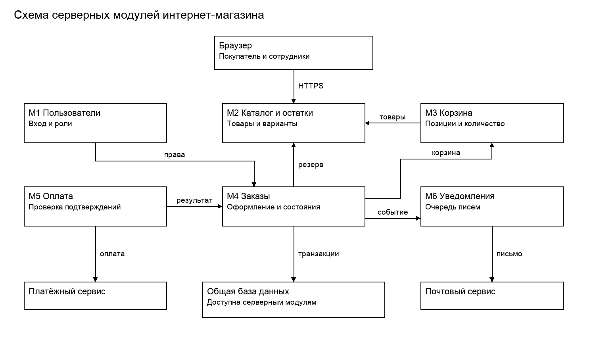

# Архитектура системы

Для первой версии выбрано одно серверное приложение с отдельными модулями. Браузер обращается к нему по HTTPS, а сервер хранит данные в общей реляционной базе. Такой вариант проще развёртывать и согласованно изменять, чем несколько отдельных сервисов.

## Модули

| Модуль | Ответственность | Основные классы |
| --- | --- | --- |
| М1 Пользователи | Регистрация, вход, роли, блокировка. | User |
| М2 Каталог и остатки | Бренды, карточки, варианты, остатки и журнал их изменения. | Brand, Product, ProductVariant |
| М3 Корзина | Состав корзины, количество, предварительная сумма. | Cart, CartItem |
| М4 Заказы | Оформление, резерв, отмена и отправка. | Order, OrderItem |
| М5 Оплата | Попытки оплаты и подтверждения платёжного сервиса. | Payment |
| М6 Уведомления | Очередь писем об оплате и отправке. | Notification |

## Взаимодействие

М1 проверяет пользователя и права перед служебными операциями. М3 получает карточки и цены из М2. М4 читает корзину из М3, проверяет остатки в М2 и сохраняет заказ. М5 создаёт платёж у внешнего провайдера и после подтверждения передаёт результат в М4. Данные банковской карты магазин не принимает и не хранит.

Общая база содержит пользователей, каталог, корзины, заказы, попытки оплаты и письма. Резервные копии базы хранятся отдельно от основной базы. Фотографии размещаются в файловом хранилище; в карточке сохраняется путь к файлу.

Журнал изменений остатков хранит variantId, userId, changedAt, oldStock и newStock. Это технический журнал М2, а не отдельный пользователь системы.

На схеме показаны основные связи модулей. Веб-интерфейс обращается ко всему серверному приложению; линия к каталогу показывает вход в систему, а не ограничение доступа только к М2.

## Схема

Исходник схемы: `4-architecture.drawio`.

## Уведомления и согласованность

М4 создаёт запись Notification после подтверждения оплаты или отправки. Запись с уникальным сочетанием заказа и типа события сохраняется в той же транзакции, что и изменение заказа. М6 читает очередь и передаёт письма почтовому сервису; ошибки записываются и повторяются не более трёх раз с интервалом 5 минут. После этого запись остаётся в состоянии «Ошибка» для разбора администратором. Сбой почты не меняет состояние заказа.

Обновление остатков и создание заказа выполняются одной транзакцией с блокировкой строк вариантов товара. Доступное количество равно остатку минус резерв. Изменить остаток ниже уже зарезервированного количества нельзя. При отмене резерв освобождается; при отправке остаток и резерв уменьшаются на количество отправленного товара.

Успешный платёж принимается только один раз по уникальному идентификатору операции провайдера. Ключ оформления также уникален для покупателя: повтор запроса после обрыва связи возвращает существующий заказ. Доступ к чужому заказу блокируется на сервере, даже если пользователь вручную подменит его номер.
