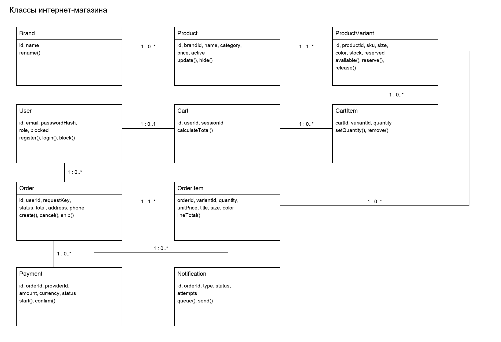
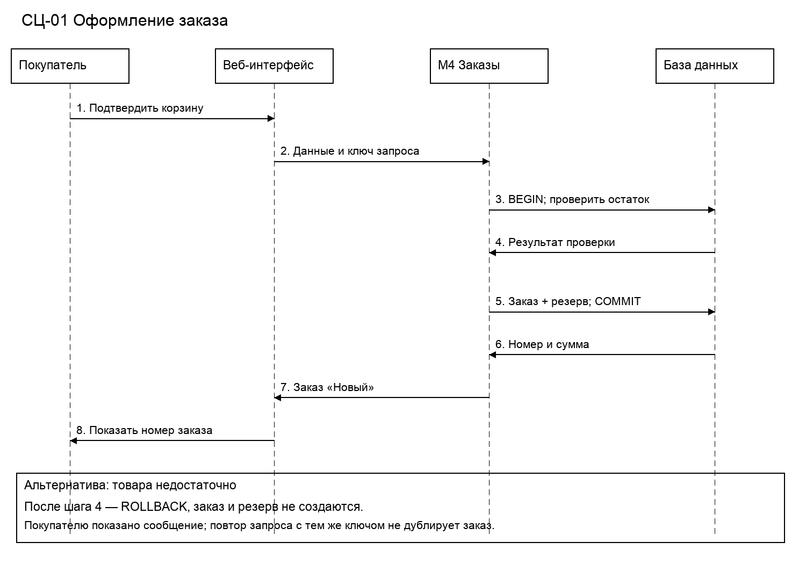

# Модель данных и тест-кейсы

## Классы

| Класс | Атрибуты | Методы |
| --- | --- | --- |
| User | id, email, passwordHash, role, blocked | register(), login(), block() |
| Brand | id, name | rename() |
| Product | id, brandId, name, category, price, active | update(), hide() |
| ProductVariant | id, productId, sku, size, color, stock, reserved | available(), reserve(), release() |
| Cart | id, userId, sessionId | calculateTotal() |
| CartItem | cartId, variantId, quantity | setQuantity(), remove() |
| Order | id, userId, requestKey, status, total, address, phone | create(), cancel(), ship() |
| OrderItem | orderId, variantId, quantity, unitPrice, title, size, color | lineTotal() |
| Payment | id, orderId, providerId, amount, currency, status | start(), confirm() |
| Notification | id, orderId, type, status, attempts | queue(), send() |

Связи: Brand 1 — 0..* Product; Product 1 — 1..* ProductVariant; User 1 — 0..1 Cart; Cart 1 — 0..* CartItem; ProductVariant 1 — 0..* CartItem; User 1 — 0..* Order; Order 1 — 1..* OrderItem; ProductVariant 1 — 0..* OrderItem; Order 1 — 0..* Payment; Order 1 — 0..* Notification.

Для гостевой корзины userId пуст, используется sessionId; при входе корзина связывается с пользователем. В OrderItem фиксируются цена, название и выбранные размер и цвет на момент заказа. В ProductVariant available = stock − reserved. В каталоге показываются только активные карточки; варианты, встречающиеся в заказах, физически не удаляются.

## Последовательность оформления

Диаграмма относится к сценарию СЦ-01.

## Тест-кейсы

Это план проверок для будущей реализации; результаты выполнения на работающем сайте не заявляются.

### ТК-01 Фильтры каталога

Требования: ФТ-01, ФТ-02.

Предусловия: В каталоге есть одежда двух брендов, размеров S и M.

Действия: Открыть каталог; выбрать один бренд и размер M; затем несовместимую комбинацию.

Ожидаемый результат: Показаны только подходящие карточки; при отсутствии совпадений показано сообщение, список пуст.

### ТК-02 Регистрация и вход

Требования: ФТ-03.

Предусловия: Email ещё не зарегистрирован.

Действия: Зарегистрироваться; войти; повторить регистрацию с тем же email.

Ожидаемый результат: Создана одна запись с ролью покупателя; вход успешен; повторная регистрация отклонена.

### ТК-03 Выбор размера и корзина

Требования: ФТ-04, ФТ-05.

Предусловия: Размер M есть в количестве 2, размер L отсутствует.

Действия: Выбрать M; добавить 2; изменить количество на 1; удалить позицию; попытаться добавить L.

Ожидаемый результат: Сумма меняется по количеству; удалённой позиции нет; отсутствующий вариант добавить нельзя.

### ТК-04 Оформление и повтор запроса

Требования: ФТ-06.

Предусловия: Покупатель вошёл; в корзине 1 доступный вариант.

Действия: Указать телефон и адрес; оформить заказ; повторить запрос с тем же ключом.

Ожидаемый результат: Создан ровно один заказ «Новый», цены и вариант сохранены; резерв увеличен один раз.

### ТК-05 Недостаточный остаток

Требования: ФТ-06.

Предусловия: В корзине 2 единицы; доступна только 1.

Действия: Подтвердить оформление.

Ожидаемый результат: Заказ не создан, резерв не меняется; показано сообщение о нехватке.

### ТК-06 Свои и чужие заказы

Требования: ФТ-07.

Предусловия: Есть два покупателя с разными заказами.

Действия: Войти первым; открыть историю; подставить номер чужого заказа.

Ожидаемый результат: История содержит только свои заказы; прямое обращение к чужому отклонено без выдачи его данных.

### ТК-07 Успешная оплата

Требования: ФТ-08, ФТ-13.

Предусловия: Есть неоплаченный заказ.

Действия: Создать попытку оплаты; передать корректное подтверждение провайдера.

Ожидаемый результат: Попытка «Успешна», заказ «Оплачен», создано одно уведомление.

### ТК-08 Отказ оплаты

Требования: ФТ-08.

Предусловия: Есть попытка «Ожидает».

Действия: Передать окончательный отказ провайдера.

Ожидаемый результат: Попытка «Отклонена», заказ «Новый»; повторная оплата доступна.

### ТК-09 Отмена и освобождение резерва

Требования: ФТ-09.

Предусловия: Есть свой заказ «Новый» без ожидающей оплаты.

Действия: Отменить заказ; повторить отмену; попытаться отменить оплаченный заказ и заказ с оплатой «Ожидает».

Ожидаемый результат: Первый заказ «Отменён», резерв освобождён один раз; две запрещённые отмены отклонены, данные не меняются.

### ТК-10 Редактирование карточки

Требования: ФТ-10.

Предусловия: Контент-менеджер вошёл.

Действия: Создать бренд и карточку; изменить цену; скрыть карточку.

Ожидаемый результат: Новая цена видна в каталоге; скрытая карточка не видна, ранее сохранённые заказы не изменились.

### ТК-11 Сборка и отправка

Требования: ФТ-11, ФТ-13.

Предусловия: Сотрудник склада вошёл; есть оплаченный заказ.

Действия: Перевести в «Собирается»; попробовать отправить без номера; затем указать номер и отправить.

Ожидаемый результат: Без номера отказ; с номером состояние «Отправлен», остаток и резерв уменьшены, письмо поставлено в очередь.

### ТК-12 Роль и блокировка сотрудника

Требования: ФТ-12.

Предусловия: Сотрудник вошёл в систему.

Действия: Администратор назначает роль склада; сотрудник проверяет доступ к отправке. Затем администратор блокирует его; сотрудник повторяет запрос и пытается войти.

Ожидаемый результат: После назначения роли разрешены складские операции. После блокировки ранее открытая сессия и новый вход не дают доступа.

### ТК-13 Повтор подтверждения оплаты

Требования: ФТ-08, ФТ-13.

Предусловия: Заказ «Новый», есть попытка «Ожидает».

Действия: Дважды передать одно и то же корректное успешное подтверждение с одинаковым providerId.

Ожидаемый результат: Одна успешная попытка, один переход в «Оплачен», одно уведомление; сумма не удваивается.

### ТК-14 Неверное подтверждение

Требования: ФТ-08.

Предусловия: Заказ на 5000 RUB ожидает оплату.

Действия: По отдельности передать сообщения с неверной подписью, суммой 500 RUB, иной валютой и номером другого заказа.

Ожидаемый результат: Каждое сообщение отклонено; заказ остаётся «Новый», письмо не создано; причина записана без платёжных реквизитов.

### ТК-15 Обновление остатка и права

Требования: ФТ-14.

Предусловия: У варианта остаток 5 и резерв 2; есть учётные записи склада и контент-менеджера.

Действия: Склад меняет остаток на 7, затем на 1 и −1; менеджер пытается изменить его на 9.

Ожидаемый результат: Разрешено только изменение на 7; остальные отклонены; журнал содержит автора, время и переход 5 → 7.

### ТК-16 Нагрузка каталога

Требования: НФТ-01.

Предусловия: Тестовый сервер 4 vCPU, 8 ГБ RAM, SSD; 10 000 товаров и 30 000 вариантов.

Действия: В течение 10 минут подавать запросы каталога и фильтров от 50 одновременных пользователей.

Ожидаемый результат: Не менее 95% ответов API получены за 2 секунды; сохранить журнал времени ответа. Это критерий будущего испытания, а не полученный результат.

### ТК-17 Защита и разграничение

Требования: НФТ-02, НФТ-03.

Предусловия: Созданы покупатели А и Б, склад, менеджер и администратор.

Действия: Проверить HTTPS и отсутствие открытого пароля в базе; обратиться к заказу А от каждой роли и покупателя Б.

Ожидаемый результат: А видит свой заказ; склад видит данные отправки; Б, менеджер и администратор не получают данные заказа; исходный пароль не хранится.

### ТК-18 Экраны разной ширины

Требования: НФТ-04.

Предусловия: Доступны страницы каталога, корзины и оформления.

Действия: Открыть каждую при ширине 360, 768 и 1440 пикселей; выполнить выбор, изменение корзины и оформление.

Ожидаемый результат: Нет горизонтальной прокрутки страницы; поля, кнопки и сообщения видны и доступны.

### ТК-19 Восстановление базы

Требования: НФТ-05.

Предусловия: Есть суточная копия и отдельная тестовая среда.

Действия: Зафиксировать время копии; восстановить базу; проверить контрольные заказы и связи.

Ожидаемый результат: Данные читаются; потеря не более 24 часов, восстановление не более 4 часов; рабочая база не перезаписана.

### ТК-20 Недоступность почты

Требования: ФТ-13.

Предусловия: Оплата подтверждена, почтовый сервис недоступен.

Действия: Запустить отправку и три повтора через 5 минут; затем проверить заказ и очередь.

Ожидаемый результат: Заказ остаётся «Оплачен»; после исчерпания повторов письмо имеет статус «Ошибка», запись не потеряна.

### ТК-21 Два заказа на последний товар

Требования: ФТ-06.

Предусловия: У варианта stock=1, reserved=0; два покупателя оформили одинаковые корзины.

Действия: Одновременно подтвердить два разных заказа.

Ожидаемый результат: Успешен только один; второй получает отказ из-за остатка; reserved=1, available=0.

### ТК-22 Поля и изменение цены

Требования: ФТ-06.

Предусловия: В корзине товар; до оформления его цена изменилась.

Действия: Оформить без телефона, затем с заполненными полями; принять новую цену.

Ожидаемый результат: Без телефона заказ не создан; новая сумма требует подтверждения; итоговый заказ содержит подтверждённую цену.
